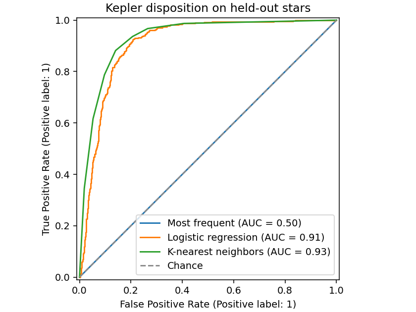

# Kepler Object Disposition Classification

A data science project by **Alper Ozoner and Ali Utku Aydın**. It compares logistic regression and k-nearest neighbors on public Kepler Objects of Interest (KOI) data from the NASA Exoplanet Archive.



## Results

The models use the same held-out set of **1,519 observations from 1,335 stars**. The training set has 6,068 observations from 5,306 stars. The scores below correspond to the archive extract used for the November 2026 run.

| Model | Accuracy | Macro F1 | ROC AUC |
| --- | ---: | ---: | ---: |
| Most-frequent-class baseline | 0.638 | 0.389 | 0.500 |
| Logistic regression | 0.847 | 0.837 | 0.910 |
| K-nearest neighbors | 0.868 | 0.860 | 0.931 |

## Reproduce

Requires Python 3.10+. Run these commands in an activated virtual environment.

```bash
python -m pip install -r requirements.txt
python evaluate.py --download --cluster
```

A first run downloads the KOI cumulative table to `data/kepler-koi.csv`. Use `--data path/to/file.csv` to run on a compatible local export. The CLI writes the dataset checksum, split sizes, metrics, optional silhouette scores and evaluation figures under `outputs/`. The [notebook](Kepler_Project.ipynb) explains the analysis in order and uses the same functions. Run it from the repository root in JupyterLab using the same Python environment.

## Evaluation design

1. Keep `CONFIRMED` and `FALSE POSITIVE` entries. The benchmark uses 12 catalog measurements and estimates. Disposition scores and vetting flags are excluded.
2. Group rows by Kepler star (`kepid`) for the held-out split and for five-fold training cross-validation.
3. Fit median imputation and scaling inside each training fold. Select the KNN neighborhood size and distance on training folds using macro F1.
4. Evaluate the selected model, logistic regression and the majority baseline on the same untouched stars.
5. Optionally fit K-means to a training-only sample and report silhouette scores for two to six clusters. Percentile clipping in this exploratory analysis limits the effect of extreme estimates.

The target is the published catalog disposition for those two classes. The reported scores apply to resolved entries in this catalog split. The [2022 group notebook](https://github.com/aydinaliutku/Kepler-Project/blob/4975a5653a0c447a4222acd694392d8abd2da25b/Kepler_Project.ipynb) records the original course analysis and its historical results.

## Data and license

NASA Exoplanet Archive. *Kepler Objects of Interest cumulative table*, [DOI 10.26133/NEA4](https://doi.org/10.26133/NEA4) and [column definitions](https://exoplanet.ipac.caltech.edu/docs/API_kepcandidate_columns.html). See [LICENSE](LICENSE) for the project code.
